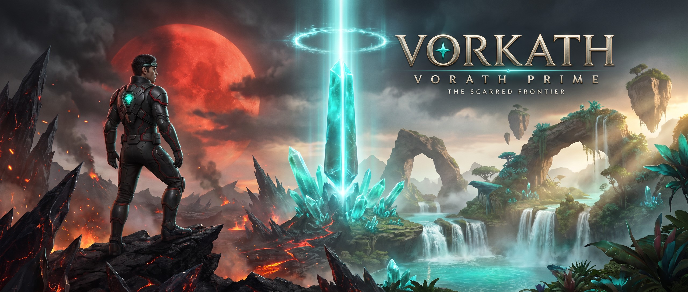
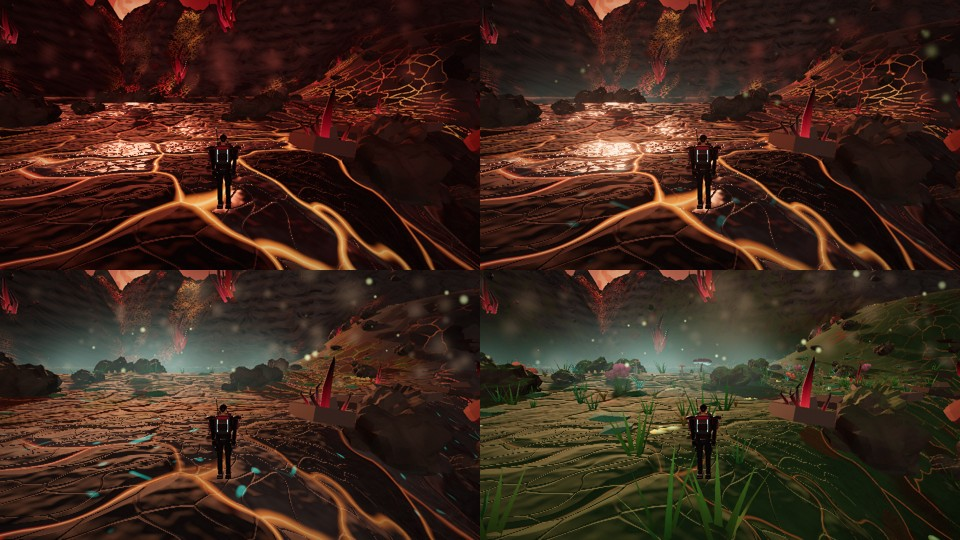
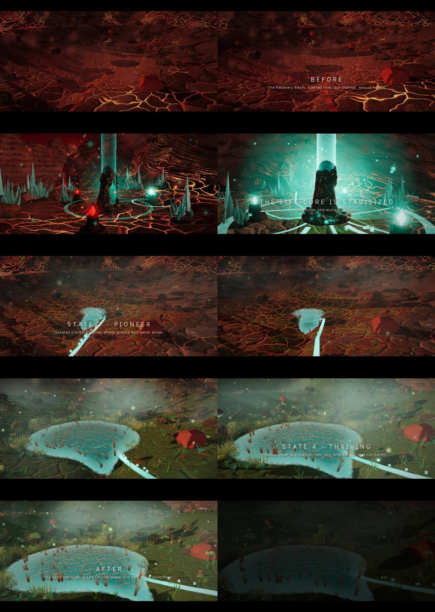

<div align="center">



<br />
<br />


# VORKATH: VORATH PRIME

**_The Scarred Frontier_ - a living-world science-fantasy exploration game for the browser**

[](https://github.com/Fallenproud/vorkath-mmorpg/actions/workflows/ci.yml)


[Overview](#overview) |
[The world](#the-world) |
[Play locally](#play-locally) |
[Controls](#controls) |
[Deployment and hosting](#deployment-and-hosting) |
[Architecture](#architecture) |
[Testing](#testing-and-verification) |
[Roadmap](#roadmap) |
[Credits](#credits-and-licensing)

</div>

> **Status, stated plainly.** Today this is a single-player, browser-based **vertical slice**: one compact region, one complete gameplay loop. The repository name mentions "MMORPG" and "living world sandbox RPG" as the long-term vision; **there is no multiplayer, networking or persistent shared world in the code yet.**
>
> **About the images.** The hero banner and emblem above are **AI-generated promotional concept art**. They show the intended look and brand, not a screenshot of the current build. Real in-game captures are in [Screenshots](#screenshots).

---

## Overview

You are a human survey explorer in graphite and obsidian armor with crimson trim and a teal Life-Core gem, crossing **The Scarred Frontier** on the alien world of Vorath Prime. The land is fractured, black and ember-lit. Somewhere in it, an exposed **Life-Core** still pulses.

Scan the terrain, collect resonance shards, stabilize the Life-Core, and then watch the land answer: water returns, pioneer plants take hold, and a dead basin turns into a living one. The ecology changes in four visible, persistent states and it follows the physical rules of the world (water, soil, slope), not a simple colour swap.

### Feature highlights

| Area | What is in the build |
|---|---|
| **Exploration** | One continuous region (about 400 m across) with six landmarks: Arrival Site, Fractured Ridge, Crystal Formation Field, Life-Core Exposure, Recovery Basin, Observation Point |
| **Traversal** | Third-person explorer with camera-relative walk, sprint, jump and landing; mouse, keyboard and gamepad input |
| **Scanner and journal** | Aim-and-hold scanning of real world objects; readings are computed from live world state; 25+ journal entries |
| **Life-Core loop** | Collect shards, seat them in three conduit nodes, hold to stabilize; up to three surges |
| **Living ecology** | Four states (Scarred, Pioneer, Growth, Thriving) on a 26 x 26 tile grid; biome-aware vegetation, water and soil gating; saved across sessions |
| **Cinematics** | Skippable planet-to-surface opening, a replayable teaser, and a 52-second **Before / After Film**, all rendered by the live game scene |
| **Presentation** | Main menu (New Game / Continue), pause menu, settings (audio, sensitivity, FOV, quality tier, reduced motion), full in-game help; fully procedural audio |
| **Persistence** | Progress, discoveries, ecology tiles and position saved locally (`localStorage`) and restored on Continue |

## The world

Vorath Prime is built around a restrained palette: **obsidian, charcoal, bloodstone and crimson**, with **luminous turquoise** reserved for Life-Core energy. Navy and marine blue are deliberately avoided.

The four ecological states are the same place at four moments in time. Same camera, same terrain, same landmarks; only the living state of the land changes:

| State | Name | What you see |
|---|---|---|
| 0 | **Scarred** | Fissured basalt plains, bare glass-like crystals, dry channel, almost no life |
| 1 | **Pioneer** | First cushions and film colonies on cooled rock where moisture gathers |
| 2 | **Growth** | Reeds in the wet corridor, shrubs on damp soil, a filling pool |
| 3 | **Thriving** | Dense cover and a few shelter trees, only where water and soil allow it |

Most of the map stays scarred even at Thriving, on purpose: life follows water and soil.

> Species names, descriptions and in-game lore are a **working draft by this project**. They are not approved Vorkath canon.

### Screenshots

Captured from the running game (software-rendered headless Chromium, so lighting quality is lower than on a real GPU).

<div align="center">



<sub>Same camera and terrain at ecological states 0 to 3 (left to right, top to bottom).</sub>

<br />
<br />



<sub>Keyframes from the in-game Before / After Film. The full capture is <a href="docs/v2/evidence/vorkath_before_after.mp4">docs/v2/evidence/vorkath_before_after.mp4</a>.</sub>

</div>

A second piece of concept art, showing the explorer holding the scanner, is in [`docs/brand/vorkath_key_art_explorer.jpg`](docs/brand/vorkath_key_art_explorer.jpg).

---

## Play locally

### Requirements

| Tool | Version |
|---|---|
| Node.js | 20 or newer (22 recommended; CI uses 22) |
| pnpm | 10 (the repo pins `pnpm@10.18.0`; enable with `corepack enable`) |
| Browser | A current Chrome, Edge or Firefox with **WebGL 2** and hardware acceleration |

### Quick start

```bash
git clone https://github.com/Fallenproud/vorkath-mmorpg.git
cd vorkath-mmorpg
pnpm install --frozen-lockfile
pnpm dev:local          # http://127.0.0.1:3000
```

Click the game to capture the mouse. If pointer lock is unavailable (for example inside an embedded frame), hold the right mouse button to look.

To choose another host or port: `HOST=0.0.0.0 PORT=8080 pnpm dev:local`.

### Scripts

| Command | What it does |
|---|---|
| `pnpm dev:local` | Vite dev server with hot reload (default `127.0.0.1:3000`) |
| `pnpm build:static` | **Portable production build**: type-check, `vite build`, then JS and font size budgets. Output in `dist/` |
| `pnpm preview:static` | Serves `dist/` at `http://localhost:4173` to test the production build |
| `pnpm test` | Unit tests (Vitest) |
| `pnpm typecheck` | TypeScript only |

> `pnpm dev` and `pnpm build` are the **Manus platform** entry points. They restore assets from Manus storage and add Manus-specific sharing metadata. On your own machine and on any other host, use `dev:local` and `build:static`.

### Controls

| Input | Action |
|---|---|
| `W` `A` `S` `D` / left stick | Move, relative to the camera |
| Mouse / right stick | Look (click the game first); right-drag as a fallback |
| `Shift` / L3 | Sprint (hold) |
| `X` / RB | Toggle walk |
| `Space` / A | Jump (hold for a higher jump) |
| `Q` / Y | Raise or lower the scanner |
| `F` or left mouse / RT | Hold on a highlighted object to scan it |
| `E` / X | Interact: collect, seat a shard, hold to stabilize the Life-Core |
| `J` or `Tab` / Back | Journal |
| `V` / R3 | Survey camera (free flight) |
| `H` | Help |
| `Esc` or `P` / Start | Pause |

### The loop in six steps

1. **Arrival Site** - learn to move, raise the scanner (`Q`) and scan the survey capsule.
2. **Fractured Ridge** - scan the exposed strata and the distant pulse signature to the north.
3. **Crystal Formation Field** - scan the spires, collect three resonance shards, avoid unstable discharge vents.
4. **Life-Core Exposure** - seat a shard in each of the three conduit nodes (`E`), then hold `E` to stabilize.
5. **Recovery Basin** - watch the pulse run down the channel and the land recover; scan the new life.
6. **Observation Point** - climb up, scan the panorama and the Succession Model, then keep exploring. Two more surges take the basin from Growth to Thriving.

---

## Deployment and hosting

The game is a **fully static site**: HTML, JavaScript, fonts and `.glb` models. There is no server code, no database and no API, so any static host will do.

### 1. Build

```bash
pnpm install --frozen-lockfile
pnpm build:static
```

The output is the `dist/` folder: about 9.6 MB on disk and about 6.3 MB over the wire with gzip. `build:static` fails if the JavaScript (2.0 MB gzip) or font (2.2 MB) budgets are exceeded.

### 2. What a host must provide

| Requirement | Detail |
|---|---|
| Static file serving | Serve `dist/` as is. The build uses a **relative base (`./`)**, so it works at the domain root *and* in a sub-folder such as `https://user.github.io/repo/` |
| HTTPS (recommended) | Standard for public sites; browsers treat `localhost` as secure for local testing |
| Compression | Enable **gzip or brotli**. The physics chunk is 4.3 MB raw but about 1.7 MB compressed |
| Caching | Files in `dist/assets/` have content hashes in their names: cache them for a year (`immutable`). Serve `index.html` with `no-cache` so releases take effect at once |
| MIME types | Standard. `.glb` files are fetched as binary, so `application/octet-stream` is fine. No special headers (no COOP/COEP) are needed |
| Embedding | The game may be embedded in an `<iframe>`; do not send `X-Frame-Options: DENY`. Mouse capture can be blocked in frames, and right-drag look is the fallback |

Saves are stored in the browser's `localStorage`, so they belong to **one origin**. Moving the game to a new domain starts players with a fresh save.

### 3. GitHub Pages (recommended for this repo)

A ready-made workflow is in [`.github/workflows/deploy-pages.yml`](.github/workflows/deploy-pages.yml).

1. In the repository, open **Settings > Pages**.
2. Under **Build and deployment > Source**, choose **GitHub Actions**.
3. Open the **Actions** tab, choose **Deploy to GitHub Pages**, and click **Run workflow**.
4. When it finishes, the site is at `https://<your-user>.github.io/<repo-name>/` (for this repo: `https://fallenproud.github.io/vorkath-mmorpg/`).

The workflow is manual by default. To deploy on every push to `main`, add `push: { branches: [main] }` under `on:`. The separate [`ci.yml`](.github/workflows/ci.yml) runs the tests and the build on every push and pull request.

> The workflow's build steps are the same commands that CI runs. The Pages deployment step itself has **not** been run, because it needs Pages to be enabled in your repository settings.

### 4. Netlify, Vercel and Cloudflare Pages

Connect the repository and use these settings:

| Setting | Value |
|---|---|
| Install command | `pnpm install --frozen-lockfile` |
| Build command | `pnpm build:static` |
| Output / publish directory | `dist` |
| Node version | 22 |
| Framework preset | None / Vite |

For Netlify, a `netlify.toml` is optional:

```toml
[build]
  command = "pnpm install --frozen-lockfile && pnpm build:static"
  publish = "dist"

[[headers]]
  for = "/assets/*"
  [headers.values]
    Cache-Control = "public, max-age=31536000, immutable"
```

> These platform settings follow each platform's usual defaults. They have **not** been tested by this project.

### 5. Your own server (nginx or any file server)

Copy the contents of `dist/` to the web root. A minimal nginx site:

```nginx
server {
  listen 80;
  server_name game.example.com;
  root /var/www/vorkath;
  index index.html;

  gzip on;
  gzip_types text/css application/javascript application/json model/gltf-binary application/octet-stream image/svg+xml;

  location /assets/ {
    add_header Cache-Control "public, max-age=31536000, immutable";
  }
  location = /index.html {
    add_header Cache-Control "no-cache";
  }
}
```

Terminate TLS in front of it (for example with Certbot or a CDN). A container is straightforward too:

```dockerfile
FROM node:22-alpine AS build
WORKDIR /app
RUN corepack enable
COPY . .
RUN pnpm install --frozen-lockfile && pnpm build:static

FROM nginx:alpine
COPY --from=build /app/dist /usr/share/nginx/html
EXPOSE 80
```

> The nginx and Docker snippets are standard configurations but were **not run** here (no nginx or Docker in the build environment).

### 6. What was actually tested for hosting

| Check | Result |
|---|---|
| `pnpm install --frozen-lockfile` and `pnpm build:static` on a clean copy of the repository (no Manus tooling) | Pass |
| `pnpm test` on a clean copy with no `dist/` | 26 of 26 pass |
| `dist/` served by a plain static file server from the **sub-folder** `/vorkath/` and opened in Chromium | Game reaches the title screen; **0 requests with status 400 or higher**; all 15 `.glb` models load with status 200; **0 console errors** |
| GitHub Pages deployment, Netlify, Vercel, Cloudflare Pages, nginx, Docker | **Not tested** |
| Real-GPU frame rate, mobile browsers, Safari | **Not tested** |

### 7. Releasing an update

Commit to `main`, let CI pass, then re-run the Pages workflow (or let your host rebuild). Hashed file names mean visitors pick up new builds without clearing caches. Older or corrupt saves are detected and handled safely (covered by the end-to-end tests).

---

## Architecture

```
src/
  main.ts            boot, input routing, game loop
  engine/            renderer + post chain, physics (Rapier), input, audio, noise, save, asset loader
  game/
    game.ts          orchestration: modes, world build, per-frame update, HUD data
    heightfield.ts   deterministic terrain height field and routes
    terrain.ts       terrain mesh, collider, biome-aware ground shader
    ecology.ts       biome classification and recovery front
    ecostate.ts      four-state ecology machine and 26 x 26 tile grid (serializable)
    biota.ts         procedural flora;  v2flora.ts  GLB-based species with LOD chunks
    v2assets.ts      GLB import, validation and geometry upgrade
    props.ts         landmarks, Life-Core, pickups, vents, spires
    explorer.ts      player controller;  character.ts  explorer model
    scannables.ts    scan targets and live readings;  discoveries.ts  journal entries
    state.ts         progress and objective state machine
    cinematics.ts    opening, teaser and Before / After Film timelines
    sky.ts, water.ts, atmosphere.ts, veins.ts, creatures.ts, crystals.ts
  ui/ui.ts           DOM menus, HUD, journal, overlays
assets/models/       GLB models (v2/ holds the 10 supplied prototypes)
tests/               Vitest unit tests
scripts/e2e/         Playwright end-to-end and acceptance scripts
docs/                reports, evidence, brand images
```

**Technology:** Three.js (rendering), Rapier (physics, WASM), TypeScript, Vite. All audio is synthesized at runtime. Terrain, sky, water, flora, rocks and the explorer are procedural or built in code. Only the `.glb` files are authored or generated assets.

**Quality tiers:** Settings > Quality (Low / Medium / High) scales shadows, particles and vegetation density.

`src/game/tuning.ts` is the Manus preview "Tweak" parameter catalog (movement and camera); keep it in sync with `config.ts` if you change those values.

---

## Testing and verification

Everything below was run during development in **software-rendered headless Chromium**. It proves behaviour; it does **not** measure real-GPU performance.

| Suite | Command | Last result |
|---|---|---|
| Unit tests (terrain route reachability, game loop, ecology state machine) | `pnpm test` | 26 of 26 pass |
| End-to-end gameplay (real hold-`E` surges, rejected duplicate/early events, reload and Continue, corrupt and pre-V2 saves, movement, journal) | `node scripts/e2e/e2e_v2.mjs` | 29 of 29 pass |
| Acceptance (six landmarks reachable and grounded, terrain and landmarks identical across the four states, per-state metrics) | `node scripts/e2e/accept.mjs` | Pass |
| Species scanning | `KEYS=bio-pioneer node scripts/e2e/t10.mjs` | Pass |

To run the browser suites: start `pnpm dev:local` in one terminal, run `npx playwright install chromium` once, then run a script from the repository root in another. They expect the game at `http://127.0.0.1:3000/`, write screenshots to `/tmp/shots` and use the game's built-in debug hooks (`window.__vorkath`) to jump between landmarks and shorten timers.

Measured in software rendering (640 x 360, low quality): 10 to 22 fps, about 210 draw calls and 645k triangles. Treat these only as a rough load indicator.

Full reports with every check, the GLB import findings and honest limitations:

- [`docs/v2/V2_REPORT.md`](docs/v2/V2_REPORT.md) - Environment Integration V2
- [`docs/CANON_PACK_INTEGRATION_REPORT.md`](docs/CANON_PACK_INTEGRATION_REPORT.md) - canon reference pack integration
- [`docs/v2/evidence/`](docs/v2/evidence) - video, comparison images and run logs

## Known limitations

- One compact region, not an open world. **No multiplayer.**
- The higher-detail rocks, plants and trees are **procedural upgrades of low-poly blockouts**: they have no texture maps, and the overall look is stylized and faceted. The explorer is built from articulated parts, not a skinned, rigged model.
- Real-GPU performance, mobile browsers, Safari and gamepad behaviour are untested.
- No touch controls. Mouse look needs pointer lock or right-drag.
- Rapier's WASM dominates download size (about 1.7 MB gzip).
- The debug hooks on `window.__vorkath` are still present in the production build.

## Roadmap

These are directions under discussion, not commitments.

- [ ] **Visual upgrade:** ambient occlusion, better shadows and volumetric fog; PBR texture sets; authored high-quality meshes in place of blockouts; a skinned, rigged explorer
- [ ] An Ultra quality tier
- [ ] More regions and a world map
- [ ] Creature ecology beyond the single grazer
- [ ] Online features, if and when the game design calls for them

---

## Credits and licensing

- **Libraries:** [three.js](https://threejs.org) (MIT), [Rapier](https://rapier.rs) (Apache-2.0)
- **Fonts:** ManusCC0, CC0 1.0 (`public/fonts/ManusCC0-LICENSE.txt`)
- **Concept art** in `docs/brand/` and the `.glb` prototypes were AI-generated or procedurally produced for this project. The reference pack images were supplied by the project owner and are used only as visual targets.
- **Lore and names** are an unapproved working draft.
- **License:** none has been chosen yet, so all rights are reserved by default. Add a `LICENSE` file to state how others may use the code and art.
